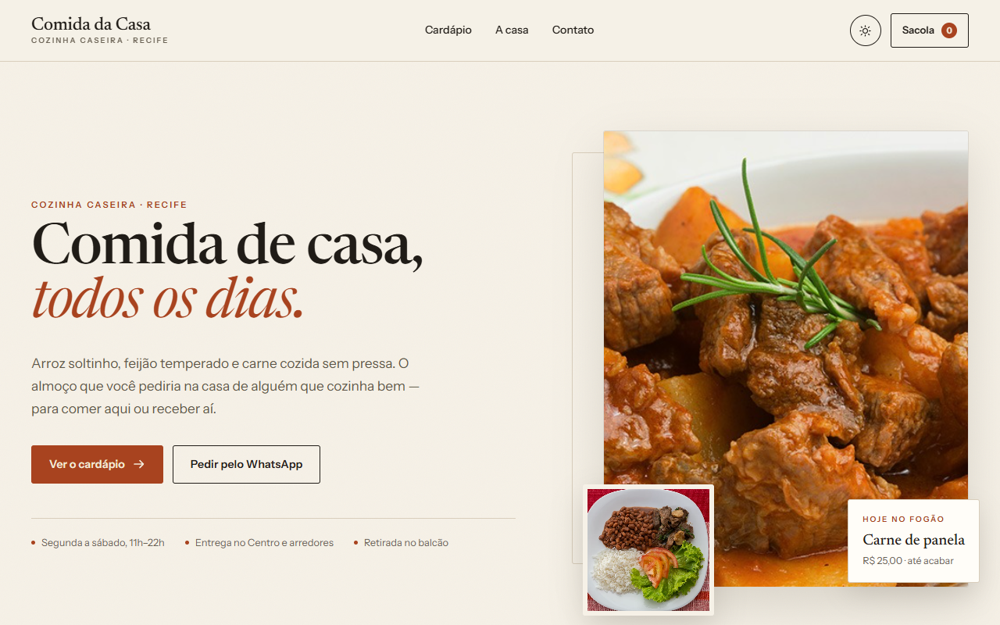
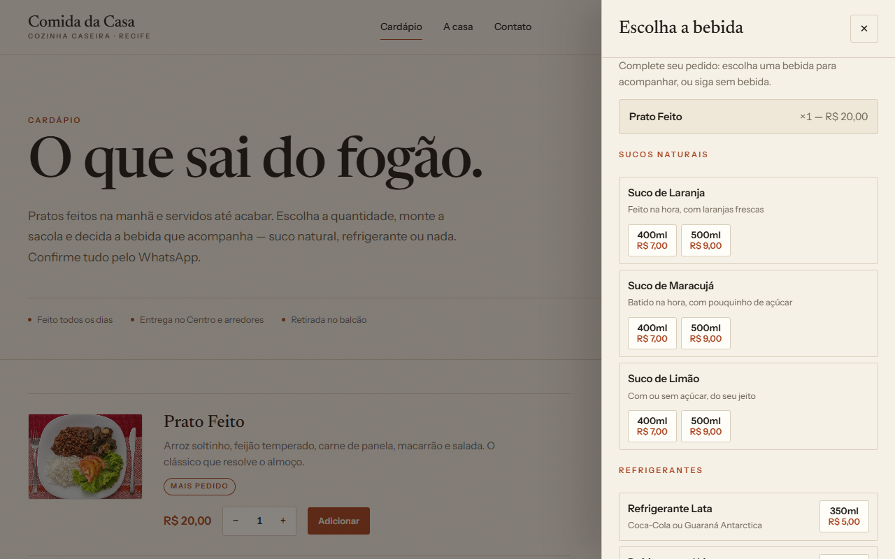

# Comida da Casa

Site de restaurante de comida caseira (Recife): cardápio interativo com escolha de bebida, sacola que fecha o pedido pelo WhatsApp e área do cliente com cadastro e login em PHP/MySQL. A parte pública é estática (HTML, CSS e JavaScript, sem build) e a área do cliente roda no XAMPP.


## No ar

- **GitHub Pages:** https://miguel-afk08.github.io/comida-da-casa/
- **Qoder Sites:** https://comida-da-casa-9rp5rgu4pnc.qoder.website/

> A área do cliente (PHP/MySQL) só roda localmente no XAMPP — veja [Como rodar a área do cliente](#como-rodar-a-área-do-cliente).

## Screenshots

| Home | Etapa da bebida |
|---|---|
|  |  |

## Stack

| Camada | Tecnologia |
|---|---|
| Interface | HTML5, CSS3 e JavaScript puro (sem frameworks, sem build) |
| Lógica | Sacola e pedidos em JS com persistência em `localStorage` |
| Back-end | PHP com sessões e `password_hash` para as senhas |
| Banco | MySQL via `mysqli` (`utf8mb4`), schema em `comida_da_casa_corrigido/banco.sql` |

## Funcionalidades

- Cardápio com fotos, tags e controle de quantidade por prato.
- **Etapa de bebida** ao adicionar o prato: sucos naturais e refrigerantes com
  tamanhos e preços (400 ml, 500 ml, 350 ml, 1 L) ou "não quero bebida".
- Sacola com total atualizado em tempo real, troca de bebida e remoção de itens;
  o valor da bebida acompanha a quantidade do prato.
- Fechamento do pedido por link do WhatsApp com itens, bebidas e total já escritos.
- Formulário de contato que monta a mensagem no WhatsApp.
- Tema claro/escuro com preferência salva no navegador.
- Cadastro com senha criptografada (`password_hash`), login por sessão e logout.
- Layout responsivo (testado de 320 px a telas grandes), navegação por teclado,
  foco preso na sacola, `prefers-reduced-motion` e textos alternativos nas imagens.
- Conteúdo visível mesmo sem JavaScript; a sacola depende de JS.

## Páginas

| Arquivo | Conteúdo |
|---|---|
| `index.htm` | Início: apresentação, pratos do dia e como pedir |
| `cardapio.htm` | Cardápio completo, quantidades, bebidas e sacola |
| `sobre.htm` | História, princípios e fotos da casa |
| `contato.htm` | Endereço, horário e formulário que abre o WhatsApp |
| `creditos.htm` | Créditos das imagens e fontes, aviso de dados fictícios |
| `style.css` | Estilos compartilhados (desktop e celular) |
| `script.js` | Pratos, bebidas, sacola, formulário, menu e animações |
| `img/` | Fotos dos pratos e favicon |

A área do cliente fica em [`comida_da_casa_corrigido/`](comida_da_casa_corrigido/README.md): login, cadastro, painel protegido por sessão e logout.

## Como rodar a parte pública

Abra `index.htm` no navegador ou sirva a pasta com um servidor local:

```bash
python -m http.server 8000
```

Depois acesse `http://localhost:8000`.

## Como rodar a área do cliente

1. Copie o projeto inteiro para `C:\xampp\htdocs\`.
2. No XAMPP, inicie **Apache** e **MySQL**.
3. Importe `comida_da_casa_corrigido/banco.sql` no phpMyAdmin.
4. Acesse `http://localhost/<pasta-do-projeto>/comida_da_casa_corrigido/index.htm`.

Passo a passo completo em [`docs/INSTALACAO.md`](docs/INSTALACAO.md).

## O que personalizar antes de publicar

- **WhatsApp:** `script.js` (`WHATSAPP`) e os links `wa.me` em `index.htm`, `contato.htm` e no rodapé.
- **Pratos e preços:** array `DISHES` em `script.js`.
- **Bebidas, tamanhos e preços:** `DRINK_OPTIONS` em `script.js`.
- **Endereço, horário e e-mail:** páginas e rodapés.
- **Banco:** credenciais em `comida_da_casa_corrigido/conexao.php`.

## Limitações

- Não há pagamento online nem painel administrativo.
- O pedido não é gravado no banco; ele é confirmado pelo WhatsApp.
- Nome, endereço, telefone, preços e relatos são fictícios (ver `creditos.htm`).

## Documentação

- [Instalação e execução](docs/INSTALACAO.md)
- [Manual do usuário](docs/MANUAL_DO_USUARIO.md)
- [Documentação técnica](docs/DOCUMENTACAO_TECNICA.md)
- [Requisitos](docs/REQUISITOS.md)
- [Banco de dados](docs/BANCO_DE_DADOS.md)
